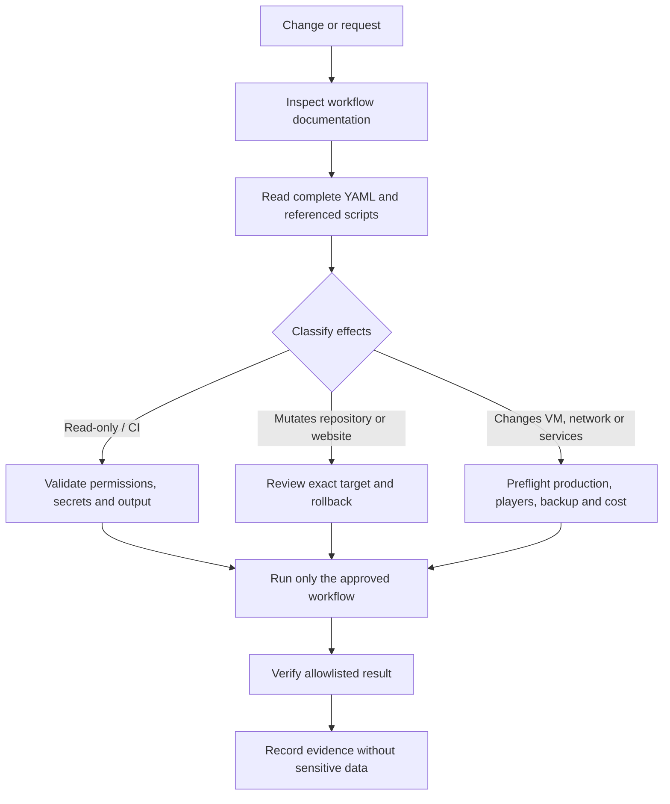

# GitHub Configuration & Operations

> **The automation layer of MC SERVER PLATFORM.**  
> CI, diagnostics and controlled repository workflows — documented with production safety as the default.

This directory contains the GitHub Actions configuration used to validate, inspect and operate parts of the MC SERVER PLATFORM. It is not a general-purpose remote console: workflows have different trust levels and some can change live infrastructure.

## What lives here

| Area | Responsibility |
|---|---|
| `workflows/` | GitHub Actions definitions and workflow-specific documentation |
| `workflows/README.md` | Workflow inventory, risk classification and operational runbook |
| Repository-level configuration | Automation defaults, permissions and supporting metadata |

Start with the [workflow catalogue and safety runbook](workflows/README.md). That document is the operational index; the complete YAML remains the source of truth for what a workflow actually does.

## Operating model

### Single-operator execution

Every manually dispatched workflow checks `github.actor == 'LMhdez'` at job level. The server start/stop workflows also require the owner identity for repository dispatches, and the private-agent deployment requires it for both manual and push runs. Issue-triggered operational workflows retain their owner-only issue-author checks. The Cloudflare Worker must use a GitHub token owned by `LMhdez`; otherwise, its workflow requests fail closed.

### Workflow classes

- **CI / validation** — checks code, tests, browser behaviour or build output. A successful CI run does not deploy production unless the YAML explicitly says so.
- **Read-only diagnostics** — query remote state. Read-only does not mean risk-free: commands can still expose sensitive data or consume cloud execution quotas.
- **Repository / website mutations** — update tracked files or public website state. Review the exact branch, paths and resulting public effect.
- **Infrastructure mutations** — can change VM power, Docker services, scheduled jobs, the private agent, network rules or deployments. Treat these as production changes.

A `workflow_dispatch` button only makes a workflow manually triggerable. It does not make the operation safe, reversible or approved.

## Mandatory safety policy

### Cost and billing

**Personal out-of-pocket budget: €0 / $0.**

- Azure for Students credits may be used for deliberately selected paid Azure compute when it is the best technically viable option at the lowest cost.
- Before starting, resizing or otherwise increasing billable Azure resources, verify the regional price, expected consumption, remaining student credit and expiry.
- Do not proceed if credit exhaustion, expiry or any other condition could cause personal billing.
- Never enable Pay-As-You-Go or accept personal billing without explicit authorization.
- GitHub-hosted runners and third-party services have separate billing. Keep them within the approved free allowances unless separately authorized.
- Do not add paid runners, subscriptions, plans or services as a workaround.

The current VM SKU is paid Azure compute, not Azure Free Tier. Student credits do not make the underlying resource free; they are a funding source with a balance and expiry.

### Secrets and privacy

Never print, log, paste into an issue, or include in an artifact:

- GitHub Secrets, tokens, environment variables or credential-bearing configuration;
- Azure credentials, service-principal values, SSH private keys or RCON passwords;
- raw SSH, Azure Run Command, Docker or RCON output;
- public IP addresses, private connection details or player-identifying data.

Use explicit allowlists for diagnostic output. Redact at the command or workflow level before data reaches GitHub logs; do not rely on manually hiding output afterwards.

### Production change controls

Before every workflow change or invocation:

1. Read this document and [the workflow catalogue](workflows/README.md).
2. Inspect the complete workflow YAML, every referenced script and every external action.
3. Review token permissions, secret exposure, pinned action versions, concurrency and environment protections.
4. Confirm the target resource and current live state; do not infer the target from old documentation.
5. Check idempotency, failure behaviour, timeout handling and a practical rollback.
6. For VM or service changes, check player activity, backup freshness and validity, maintenance window and operation locks.
7. For Azure compute changes, complete the financial preflight above.
8. Execute only the authorized operation and verify its result using sanitized, allowlisted fields.

Never run workflows concurrently when they use Azure Run Command or mutate the same VM, services, network or scheduled jobs.

## Production boundaries

The platform deliberately separates components and deployment paths:

- **GitHub CI** validates repository changes; it is not proof that a separate production deployment happened.
- **Cloudflare Worker** deployment is a distinct operation.
- **Private VM agent** installation or update is a distinct operation.
- **GitHub Pages / frontend** publication is separate from Worker and VM changes.
- **Azure VM power and Minecraft service operations** are production actions with availability and cost implications.

A merged pull request is not, by itself, confirmation that all these components have been deployed. Verify each deployment independently.

The private Python agent must remain private and must not be exposed as a public management endpoint. Do not move SSH, RCON, Docker or Azure management credentials into frontend code or public repository files.

## Maintenance mode

The website maintenance flag is informational. The maintenance workflow changes the tracked `maintenance.json` website state; it does not stop Minecraft, power off the VM, change the Worker, or alter network rules.

Always inspect the workflow inputs and resulting diff before enabling or disabling the notice.

## Source of truth and keeping this guide current

The [workflow catalogue](workflows/README.md) lists the workflows, their purpose and their known risk class. It must be updated whenever workflows are added, removed or materially changed.

When documentation and implementation disagree, the complete workflow YAML and referenced scripts define the actual behaviour. Correct the documentation in the same change so operators are not relying on stale instructions.

This guide is intentionally conservative: when a workflow's effect, target, cost or rollback is unclear, stop and investigate before running it.
