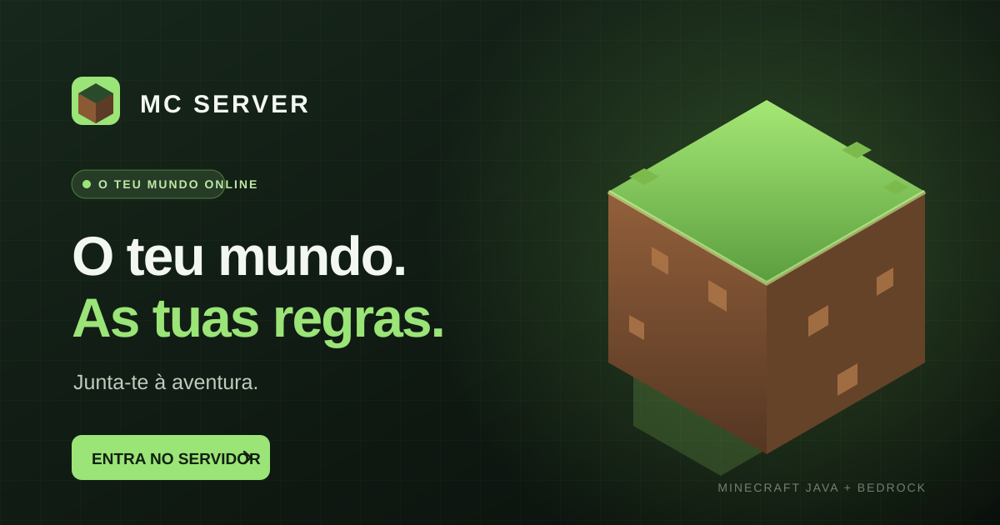
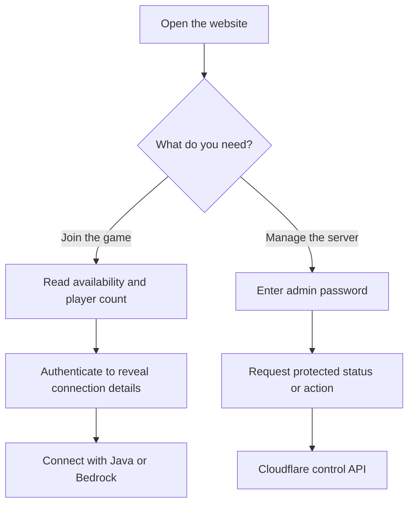
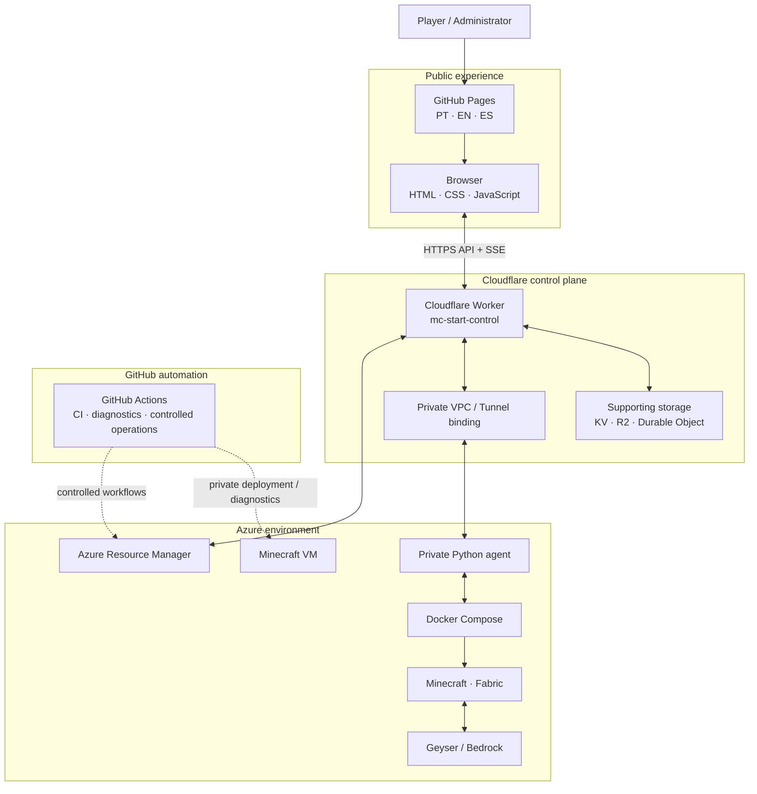
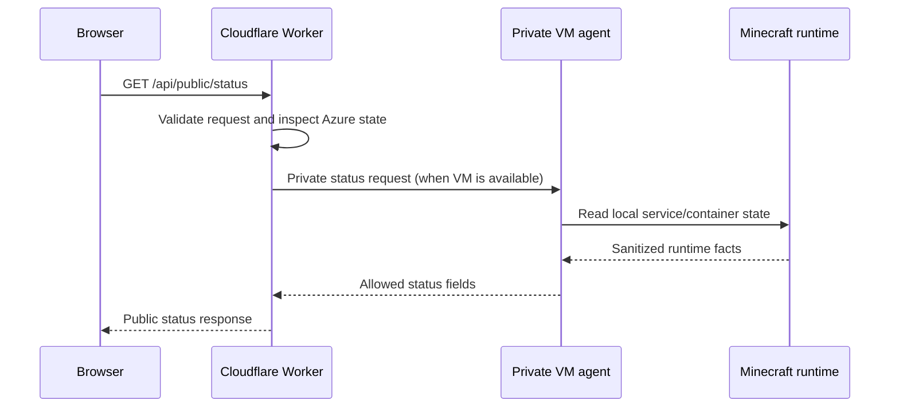
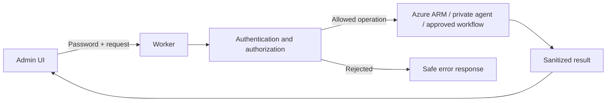

# MC SERVER PLATFORM

> **One place to see the world, understand the stack, and operate the server.**
>
> A multilingual Minecraft community portal backed by a private control plane on Cloudflare and Azure.

[](https://github.com/LMhdez/mc-start/actions/workflows/validate.yml)
[](#multilingual-experience)
[](#technology)
[](#architecture)
[](#cost-and-service-policy)

<p align="center">
  
</p>

---

## The product

**MC SERVER PLATFORM** is the player-facing website and operational control plane for a self-hosted Minecraft server.

For players, it answers the essentials: *Is the server available? How many people are online? How do I connect?*  
For administrators, it provides protected controls and a technical overview without exposing the VM or its management services directly to the Internet.

What started as a small server start page has grown into a coordinated system: a static multilingual website, a Cloudflare API layer, a private VM agent, automated validation, and carefully separated operational workflows.

### At a glance

| Experience | What it provides |
|---|---|
| Player portal | Server availability, public player count, connection guidance and technical overview |
| Live status | Initial status API plus Server-Sent Events (SSE) for updates |
| Protected administration | Password-protected server actions and private connection details |
| Technical transparency | Detected software and component versions |
| Operations | Separate GitHub Actions workflows for diagnostics and controlled changes |
| International access | Portuguese, English and Spanish entry points and social metadata |

## Product experience

The website is deliberately lightweight. It is a static application, not a framework-heavy dashboard, and it does not need a user account just to read public status.



### Player-facing capabilities

- **Availability at a glance** — the page retrieves the current public status instead of trusting a stale cached browser value.
- **Live updates** — SSE delivers public status changes and player-count updates while the page is visible.
- **Connection details on demand** — sensitive connection information is not embedded in the page source or repository; it is revealed through the protected flow.
- **Java and Bedrock support** — the service exposes the relevant connection guidance for both editions.
- **Technical overview** — the page presents detected server software and component versions.
- **Accessible, responsive interface** — semantic HTML, keyboard-friendly controls, status announcements and layouts for different screen sizes.

### Administrator capabilities

- Password-protected access to management actions.
- Request a fresh server status.
- Start the Azure VM through the protected control path.
- Reveal private connection details only after authentication.
- Keep diagnostics separate from workflows that mutate production.

> The public website is not an unrestricted remote console. It does not expose RCON, Docker, SSH, the VM agent, or raw Azure credentials to the browser.

## Architecture

The system is split into independent layers so that the public website never needs direct access to the VM management plane.



### Component responsibilities

| Layer | Technology | Responsibility |
|---|---|---|
| Website | GitHub Pages, HTML, CSS, vanilla JavaScript | Static multilingual UI and browser-side interactions |
| Control API | Cloudflare Workers | Authentication, public/private API routing and Azure integration |
| Private connectivity | Cloudflare VPC / Tunnel integration | Worker-to-agent communication without a public agent port |
| VM agent | Python | Narrow, authenticated operations and local server telemetry |
| Game runtime | Azure VM, Docker Compose, Fabric | Runs the Minecraft server and its supporting services |
| Bedrock compatibility | Geyser | Allows supported Bedrock clients to join |
| Automation | GitHub Actions | Validation, audits, diagnostics and explicitly controlled operations |
| Supporting state | Cloudflare KV, R2 and Durable Objects | Implementation-specific status, technical snapshots and budget/state coordination |

### Request and data flows

**1. Public status**



**2. Live status (SSE)**

```mermaid
sequenceDiagram
    participant B as Browser
    participant W as Worker
    participant A as VM agent
    participant L as Local runtime checks

    B->>W: GET /api/public/events
    W->>W: Validate origin and Azure state
    W->>A: Open private event stream
    A->>L: Start/reuse shared watcher
    loop While clients are connected
        L->>L: Read local Docker / service / game state
        A-->>W: Public status change or heartbeat
        W-->>B: SSE event
    end
    Note over B,A: Stream is read-only; it never starts, stops or restarts services.
```

**3. Protected administration**



The exact route, request schema and authorization rules are implementation details: consult `cloudflare/worker.js` and its tests before integrating a client.

## Live status: design and boundaries

The status pipeline is intentionally passive.

- The browser obtains an initial snapshot from `GET /api/public/status`.
- It then opens `GET /api/public/events` for Server-Sent Events.
- The Worker validates the request and Azure state, then forwards the private agent stream when the VM is available.
- A shared watcher in the VM agent performs local read-only checks at a five-second interval while at least one SSE client is connected.
- The watcher shares work between connected browsers and emits only permitted public fields when they change; heartbeats refresh the check timestamp.
- Hidden tabs close their stream. When visible again, the page refreshes the initial state and reconnects.
- If the VM is deallocated, the Worker reports the Azure state and the browser retries at a slower interval. Transient failures use backoff.

**SSE does not perform operations.** It does not trigger Azure start/stop, GitHub Actions, Docker changes, systemd, cron, autostop, or server restarts. A stream connection is an incoming Worker request; individual events are not separate requests, while reconnections are.

## Technology

### Frontend

- Static HTML, CSS and vanilla JavaScript — no frontend framework or bundler.
- Shared UI and logic across Portuguese (`/`), English (`/en/`) and Spanish (`/es/`).
- Each localized entry page includes its own language, canonical URL, description, Open Graph and Twitter metadata in the initial HTML. Social crawlers do not need JavaScript or local storage to discover the correct language.
- `scripts/generate-localized-pages.mjs` generates localized entry pages from the root template. Use its check mode to detect drift.
- SVG social artwork is maintained as editable source; GitHub Actions generates the corresponding 1200×630 PNG previews.
- The browser handles the private status decryption flow; do not move cryptographic responsibilities into the Worker without a separate security and resource review.

### Cloudflare Worker

- Main implementation: `cloudflare/worker.js`.
- Production configuration: `cloudflare/wrangler.toml`.
- Isolated test configuration: `cloudflare/wrangler.test.toml` — **never use this file for deployment**.
- Responsibilities include public/private API routes, authentication, Azure ARM integration, GitHub Actions fallback paths and private agent connectivity.
- The production Worker is a separate release from the website and VM agent.

### VM agent and game runtime

- Agent implementation: `vm/mc-agent.py`.
- The agent is private and must not be exposed through a public VM port. The intended path is through the configured Cloudflare private connectivity.
- The game runtime is managed with Docker Compose and Fabric.
- Geyser provides Bedrock connectivity alongside Java Edition.
- Current infrastructure facts, sanitized configuration and operational runbooks live in the separate [mc-server-infrastructure repository](https://github.com/LMhdez/mc-server-infrastructure), not in this website repository.

### Tests and automation

- Node.js 22 in CI.
- Vitest 4 with the Cloudflare Vitest plugin for Worker and Durable Object tests.
- UI audit scripts and browser-based accessibility/responsiveness checks.
- Wrangler dry-run as a validation step; this is not a production deployment.
- GitHub Actions separate validation and operational workflows by risk.

## Repository map

| Path | Purpose |
|---|---|
| `index.html` | Portuguese root entry page and shared page template |
| `en/`, `es/` | Generated localized entry pages |
| `style.css` | Shared responsive visual system |
| `script.js` | UI, language handling, API calls and live status |
| `status-crypto.js` | Browser-side private status cryptography |
| `maintenance-status.js`, `maintenance.json` | Informational maintenance notice |
| `social-preview*.svg` | Editable localized social preview artwork |
| `cloudflare/worker.js` | Cloudflare API and control plane |
| `cloudflare/DEPLOYMENT-RUNBOOK.md` | Worker deployment gates and rollback |
| `vm/mc-agent.py` | Private VM agent |
| `tests/` | Worker, integration and UI tests |
| `scripts/` | Localized-page and build utilities |
| `.github/workflows/` | CI, audits and operational workflows |
| `PRODUCTION-READINESS-2026-11-04.md` | Dated production-readiness evidence |
| `REPOSITORY-AUDIT-2026-11-03.md` | Dated repository audit |

For current VM state, backups, sanitized configuration and operational procedures, use [mc-server-infrastructure](https://github.com/LMhdez/mc-server-infrastructure).

## Local development

### Requirements

- Node.js 22 (recommended to match CI).
- npm.
- A local browser for manual UI checks.

### Install and test

```bash
npm install --legacy-peer-deps --no-audit --no-fund
npm run test:cloudflare
node scripts/generate-localized-pages.mjs --check
node tests/ui-audit.cjs
```

The UI audit may require the browser dependencies described by `.github/workflows/ui-browser-audit.yml`. Tests should use isolated fixtures and test bindings. They must not access the production VM, real player data, RCON, production secrets or paid services.

### Change workflow

1. Identify the affected layer: website, Worker, VM agent, workflow or infrastructure.
2. Read the relevant local README and the complete implementation/runbook.
3. Classify the change as read-only, mutating, disruptive, destructive or potentially billable.
4. Make the smallest coherent change and update the relevant documentation.
5. Run the relevant tests, syntax checks and CI validation.
6. Review the complete diff for security, compatibility and unintended operational effects.
7. Treat each production component as a separate release with its own approval and verification.

## Security model

Security boundaries are part of the product, not optional deployment advice.

- **No secrets in Git.** Never commit passwords, API tokens, private keys, RCON credentials, raw authentication output or secret-bearing logs.
- **Sanitize output.** Use explicit allowlists. Never dump complete environment variables, headers, player lists, private payloads or authentication responses into logs, issues or chat.
- **No public agent port.** The Python agent must remain private; do not expose its service port as a workaround.
- **Authentication is not Origin validation.** Browser-origin checks are useful defence-in-depth, not a replacement for authentication and authorization.
- **Least disclosure.** Public status must not expose connection IPs, credentials, player identities or world data. Sensitive connection details use the protected reveal flow.
- **Read-only telemetry.** SSE is not an administrative channel.
- **No false confidence.** A passing CI run does not prove a production deploy; HTTP 200 does not prove a successful Java or Bedrock login; a merged PR does not mean every component has been released.
- **Rate limiting caveat.** In-memory limits per Worker isolate are best-effort, not a global atomic rate limit. The admin password must be long, random and unique.

Report security issues privately to the maintainers rather than publishing exploit details or credentials in an issue.

## Operations and release boundaries

The system has multiple independently deployed components:

| Component | Delivery path | What success means |
|---|---|---|
| Website | GitHub Pages | Static site build/publish completed and the deployed pages are verified |
| Worker | Explicit Wrangler deployment | Production Worker version and traffic allocation are verified |
| VM agent | Dedicated GitHub Actions deployment workflow | Service is active and health endpoint is healthy |
| Minecraft runtime | Dedicated infrastructure workflows/runbooks | Target VM, game process, backups and player impact are verified |

Never infer that one release automatically deploys the others. In particular, merging frontend code does not publish the Worker or update the VM agent.

The `maintenance.json` banner is informational. Enabling it changes the website notice; it does not stop Minecraft, block game connections or change Azure resources.

## Cost and service policy

**Personal out-of-pocket spending target: €0 / $0.** The project is designed around free allowances and already-included student benefits. Do not create paid resources, enable paid plans, upgrade services, start trials, enable Pay-As-You-Go, or accept personal billing without explicit authorization.

Important distinctions:

- The current Azure VM uses billable compute covered by Azure for Students credits; it is **not Azure Free Tier**.
- Azure student credits are separate from GitHub and Cloudflare quotas and benefits.
- The Worker is intended to remain within the applicable free allowance. Do not enable Workers Paid or paid add-ons.
- GitHub-hosted runners, storage and third-party services have independent quotas and billing rules.
- Before changing compute, verify the regional price, expected consumption, remaining credit and expiry. Block an operation if personal charges could result.

Free-tier limits and student-benefit terms can change. Verify the active account and service terms before any change that could affect cost.

## Current production snapshot

The following is a dated documentation snapshot, **not live telemetry**. Last recorded on **4 November 2026**:

- The documented Azure deployment is in Belgium Central.
- Minecraft 26.3 runs on Fabric in Docker Compose.
- The website is served by GitHub Pages; the Cloudflare Worker is the control API, not the game address.
- The Worker production release recorded in the audit is version 56.
- The frontend, Worker and private agent have the public SSE status flow.
- The private agent was deployed separately from the Worker.
- The PR proposing a unified maintenance field in the status contract remains separate from the deployed implementation; the website maintenance notice continues to use `maintenance.json`.
- Java and Bedrock ports are documented in the infrastructure runbook. External client connectivity should be tested separately; a listening port alone is not proof of end-to-end access.

See [production readiness evidence](PRODUCTION-READINESS-2026-11-04.md) and the infrastructure repository's [current state](https://github.com/LMhdez/mc-server-infrastructure/blob/main/docs/current-state.md). Always re-check live state before an operational action.

## Naming and project identity

The repository slug remains `mc-start` for compatibility with the existing GitHub Pages URL, workflows and integrations. The product has outgrown the original “start page” concept, so this README uses **MC SERVER PLATFORM** as a descriptive product identity without prematurely renaming infrastructure identifiers.

A future repository/domain rename should be a separate migration: check Pages URLs, canonical and social metadata, workflow references, Worker configuration, external links and any integrations before changing it.

---

<p align="center">
  <strong>MC SERVER PLATFORM</strong><br>
  <sub>A small, focused interface over a deliberately separated game and operations stack.</sub>
</p>
